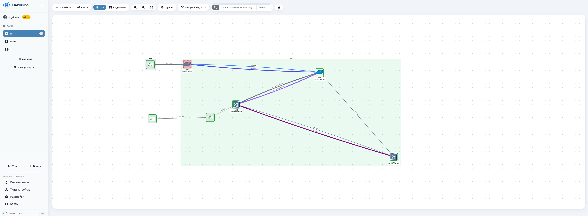

<div align="center">

# LinkVision

**Карта сети, на которой видно главное.**

Визуализация инфраструктуры · ICMP-мониторинг · Совместная работа

[Установка](#установка) · [Развёртывание](#развёртывание-за-nginx) · [Обновление](#обновление) · [Разработка](#разработка)

</div>



LinkVision объединяет топологию сети и состояние оборудования в одном интерфейсе. Размещайте устройства на карте, описывайте соединения и следите за доступностью, задержкой, потерями пакетов и джиттером. Изменения доставляются открытым клиентам через Socket.IO.

## Возможности

| Область | Что доступно |
| --- | --- |
| **Топология** | Несколько карт, фоновые изображения, типы устройств, несколько IP, настраиваемые связи и подписи интерфейсов |
| **Организация** | Папки карт, вложенные группы, сворачивание групп, фигуры для обозначения зон |
| **Работа с картой** | Поиск, фильтры состояния, мини-карта, полноэкранный режим, копирование устройств, массовое редактирование и автораскладка выделенного фрагмента |
| **Слои** | Назначение устройств и связей слоям, персональная видимость слоёв для каждой карты |
| **Мониторинг** | ICMP-проверки, профили качества, история доступности и графики качества связи |
| **Совместная работа** | Синхронизация изменений карты, блокировка редактирования, права пользователей и наследование прав папок |
| **Интерфейс** | Светлая и тёмная темы, русский и английский языки, адаптивный тулбар |
| **Эксплуатация** | JSON-импорт и экспорт топологии, аудит, резервные копии, локальные команды администратора |

При восстановлении соединения клиент синхронизирует карту с сервером. При изменении версии сборки открытая страница может автоматически обновиться — это удобно для постоянно включённых экранов.

## Установка

Основной сценарий эксплуатации — **Linux, SQLite, один процесс приложения за Nginx с HTTPS**. Windows подходит для локального тестирования; инструкции приведены отдельно.

Требования:

- Python **3.10+**; текущая локальная тестовая среда — Python 3.12.
- Git и pip; для автоматического установщика — Ubuntu/Debian с `apt-get`.
- Доступ к ICMP: при недоступности raw-сокетов используется системная команда `ping`.
- Node.js и npm нужны только при изменении и сборке фронтенда. Готовые бандлы уже находятся в репозитории.

### Linux: автоматическая установка

```bash
git clone https://github.com/Sivolen/LinkVision.git /opt/LinkVision
cd /opt/LinkVision
sudo bash install.sh
```

Команды предполагают право записи в `/opt`. При необходимости подготовьте каталог от имени администратора.

Установщик создаёт `venv`, устанавливает зависимости, создаёт `.env` со случайным ключом, запускает `manage.py migrate` и предлагает задать пароль первого администратора. При запуске от root также устанавливается и запускается `linkvision.service`. Для ввода пароля нужен интерактивный терминал.

Существующий `.env` сохраняется. Если администратор уже существует, его пароль не меняется.

| Параметр установщика | Назначение |
| --- | --- |
| `LINKVISION_INSTALL_SERVICE=true` / `false` | Установка и запуск systemd-службы; автоматически включены при запуске от root |
| `LINKVISION_PORT=8005` | Порт Gunicorn, по умолчанию `8005` |
| `LINKVISION_HTTPS=True` | Записать Secure-cookie в новый `.env` |
| `LINKVISION_BEHIND_PROXY=True` | Записать доверие reverse proxy в новый `.env` |
| `LINKVISION_PYTHON=/path/to/python3` | Выбрать интерпретатор |
| `-p http://proxy:port` | Прокси для установки Python-пакетов |

Для HTTPS-развёртывания:

```bash
sudo LINKVISION_HTTPS=True LINKVISION_BEHIND_PROXY=True bash install.sh
```

> В `.env` логические значения читаются строго как `True` и `False`, с заглавной буквы. Если файл уже существует, измените параметры в нём самостоятельно. Nginx и сертификаты установщик не настраивает. Создаваемая служба слушает `0.0.0.0`; ниже описан переход на локальный адрес backend.

### Linux: ручная установка

Из каталога клонированного проекта:

```bash
python3 -m venv venv
./venv/bin/python -m pip install --upgrade pip
./venv/bin/python -m pip install -r requirements.txt
./venv/bin/python manage.py migrate
./venv/bin/python manage.py create-admin
./venv/bin/python wsgi.py
```

Откройте [http://127.0.0.1:5000](http://127.0.0.1:5000). Прямой запуск `wsgi.py` использует порт `5000` и слушает все сетевые интерфейсы. Для публичного сервера используйте развёртывание за reverse proxy.

`.env` создаётся автоматически при первом импорте приложения. Не копируйте ключ-заглушку из `.env.example`: либо дайте приложению сгенерировать ключ, либо задайте свой.

### Windows: локальное тестирование

Из PowerShell в каталоге проекта, при установленном Python 3.12:

```powershell
py -3.12 -m venv .venv
.\.venv\Scripts\python.exe -m pip install --upgrade pip
.\.venv\Scripts\python.exe -m pip install -r requirements.txt
.\.venv\Scripts\python.exe manage.py migrate
.\.venv\Scripts\python.exe manage.py create-admin
.\.venv\Scripts\python.exe wsgi.py
```

Откройте [http://127.0.0.1:5000](http://127.0.0.1:5000). Активация окружения необязательна: команды явно используют его Python. Gunicorn и systemd предназначены для Linux; установку всех зависимостей на чистой Windows-системе следует проверять отдельно.

Если порт занят, найдите процесс, прежде чем останавливать его:

```powershell
Get-NetTCPConnection -LocalPort 5000 -State Listen |
    Select-Object LocalAddress, LocalPort, OwningProcess
```

У `wsgi.py` нет параметра `--port`. Для временного локального запуска на другом порту:

```powershell
.\.venv\Scripts\python.exe -c "import wsgi; wsgi.socketio.run(wsgi.app, host='127.0.0.1', port=8765, debug=False, use_reloader=False, allow_unsafe_werkzeug=True)"
```

## Учётная запись администратора

Пароль задаётся локально и не печатается в консоль или журналы. Команда запрашивает его дважды; по умолчанию имя — `admin`. После первого входа потребуется сменить временный пароль.

```bash
./venv/bin/python manage.py create-admin
./venv/bin/python manage.py create-admin username
```

Для сброса пароля существующего администратора остановите службу и выполните:

```bash
sudo systemctl stop linkvision.service
cd /opt/LinkVision
sudo ./venv/bin/python manage.py reset-admin-password admin
sudo systemctl start linkvision.service
```

На Windows используйте `.\.venv\Scripts\python.exe` вместо `./venv/bin/python`. Команда должна видеть ту же базу и окружение, что и сервер. После сброса предыдущие сессии теряют доступ; временный пароль требуется сменить при следующем входе.

## Конфигурация

Настройки окружения находятся в `.env` в корне проекта. Переменные, заданные окружением процесса, имеют приоритет над файлом. Полный пример — [.env.example](.env.example).

| Переменная | Назначение | По умолчанию |
| --- | --- | --- |
| `SECRET_KEY` | Подпись сессий и CSRF; сохраняйте между перезапусками | Генерируется в `.env` |
| `DATABASE_URL` | URL SQLAlchemy | SQLite: `webnetmap.db` в корне проекта |
| `LOG_LEVEL` | Уровень журналов | `INFO` |
| `FLASK_DEBUG` | Отладка при запуске `wsgi.py` | `False` |
| `SESSION_COOKIE_SECURE` | Cookie только по HTTPS | `False` |
| `BEHIND_PROXY` | Доверие заголовкам `X-Forwarded-*` одного reverse proxy | `False` |
| `SOCKETIO_PING_INTERVAL` | Интервал heartbeat | `25` с |
| `SOCKETIO_PING_TIMEOUT` | Таймаут heartbeat | `30` с |
| `REDIS_URL` | Внешнее хранилище rate limiting | В памяти процесса |
| `SENTRY_DSN` | Отправка ошибок в Sentry | Не задано |

Для HTTPS за Nginx:

```dotenv
FLASK_DEBUG=False
SESSION_COOKIE_SECURE=True
BEHIND_PROXY=True
```

Для обычного HTTP локально оставьте два последних значения `False`, иначе браузер не будет передавать сессионную cookie. Изменения окружения требуют перезапуска приложения.

## Развёртывание за Nginx

```text
Браузер → HTTPS / Nginx → HTTP / 127.0.0.1:8005 → LinkVision
```

### Служба приложения

В репозитории есть [шаблон systemd](linkvision.service). Установщик генерирует его под путь checkout. При ручной настройке проверьте `WorkingDirectory`, путь к `venv` и пользователя службы.

Для Nginx на том же сервере задайте локальный bind через override:

```bash
sudo systemctl edit linkvision.service
```

```ini
[Service]
ExecStart=
ExecStart=/opt/LinkVision/venv/bin/gunicorn -k eventlet -w 1 -b 127.0.0.1:8005 wsgi:app
```

```bash
sudo systemctl daemon-reload
sudo systemctl restart linkvision.service
sudo systemctl status linkvision.service
```

Используйте **один worker**: каждый процесс приложения запускает собственный мониторинг. Несколько workers требуют отдельного решения для фоновых задач и межпроцессной доставки событий.

Шаблон службы запускается от root. При переходе на отдельного пользователя обеспечьте доступ к БД, `.env`, каталогам загрузок и журналов, а также возможность ICMP-проверок. Повторный запуск установщика может перегенерировать основной файл службы; override systemd хранится отдельно.

### Проксирование HTTP и WebSocket

Следующие блоки добавляются в существующий Nginx `server`, обслуживающий ваш HTTPS-домен. TLS-сертификат и `listen 443 ssl` настраиваются отдельно.

```nginx
location / {
    proxy_pass http://127.0.0.1:8005;
    proxy_set_header Host $host;
    proxy_set_header X-Real-IP $remote_addr;
    proxy_set_header X-Forwarded-For $remote_addr;
    proxy_set_header X-Forwarded-Proto $scheme;
    proxy_read_timeout 120s;
    proxy_cache off;
    client_max_body_size 16m;
}

location /socket.io/ {
    proxy_pass http://127.0.0.1:8005;
    proxy_http_version 1.1;
    proxy_set_header Upgrade $http_upgrade;
    proxy_set_header Connection "upgrade";
    proxy_set_header Host $host;
    proxy_set_header X-Forwarded-For $remote_addr;
    proxy_set_header X-Forwarded-Proto $scheme;
    proxy_buffering off;
    proxy_read_timeout 120s;
    proxy_cache off;
}
```

Пример рассчитан на один Nginx непосредственно перед приложением. `proxy_read_timeout` должен превышать сумму интервала и таймаута Socket.IO. Не кешируйте HTML и `/api/app-version`: они участвуют в обнаружении обновлений. Проверяйте конфигурацию командой `sudo nginx -t` перед её применением.

Клиент использует публичный адрес сайта для API и Socket.IO; при HTTPS соединение WebSocket идёт через WSS. Внутренний адрес backend не нужно прописывать во фронтенде.

## База данных и миграции

**Единая команда миграций — `manage.py migrate`.** Приложение проверяет совместимость существующей базы при старте; структурные обновления нужно выполнять заранее, при остановленном сервере.

```bash
./venv/bin/python manage.py migrate
```

Для SQLite команда создаёт резервную копию, применяет поддерживаемые изменения, проверяет схему и записывает маркер совместимости после успешной проверки. Повторный запуск поддерживается. Новые установки создаются по текущей ORM-схеме, включая слои и персональные настройки их видимости.

Старые скрипты `apply_migrations.sh`, `fix_db.py`, `migrate_ordering.py` и `migrate_quality.py` оставлены для совместимости. Отдельную цепочку Flask-Migrate/Alembic настраивать не нужно.

**PostgreSQL:** драйвер для выбранного `DATABASE_URL` устанавливается отдельно. Пустая база может быть создана приложением, но автоматического обновления существующей PostgreSQL-схемы нет. `manage.py migrate` поддерживает SQLite; для PostgreSQL подготовьте схему текущих моделей собственными средствами до запуска.

## Мониторинг

Параметры ICMP и хранения истории задаются в административном разделе. Изменения мониторинга применяются на границе цикла.

| Параметр | Значение по умолчанию | Диапазон |
| --- | --- | --- |
| Пакеты на проверку | 4 | 1–10 |
| Интервал цикла | 10 с | 5–300 с |
| Таймаут пакета | 1 с | 0,2–10 с |
| Параллельные проверки | 150 | 10–300 |
| Хранение истории | 7 дней | 1–3650 дней |

Качество оценивается по потерям, задержке и джиттеру. Пороги задаются профилями качества; один профиль служит общим значением по умолчанию. История качества хранится пятиминутными агрегатами.

Подбирайте интервал с учётом количества устройств и доли недоступных адресов: таймауты увеличивают длительность цикла. Если появляются предупреждения о перегрузке или срывах связи, проверьте журналы и увеличьте интервал; увеличение числа параллельных проверок само по себе не гарантирует улучшения.

### Слои карты

Откройте иконку слоёв перед меню «Дополнительно». Создайте слой, выделите устройства или связи и назначьте их кнопкой с галочкой в строке слоя. Счётчики показывают количество устройств и связей.

Видимость сохраняется для конкретного пользователя и карты. Объекты без назначений остаются видимыми; объект в нескольких слоях виден, если включён хотя бы один из них. Удаление слоя не удаляет устройства и связи. Изменение слоёв требует прав редактирования и разблокированной карты.

JSON-импорт и экспорт сохраняют топологию. Перенос назначений слоёв через этот формат пока не реализован.

## Обновление

Для установленной службы с SQLite:

```bash
sudo systemctl stop linkvision.service
cd /opt/LinkVision
sudo git pull --ff-only
sudo ./venv/bin/python -m pip install -r requirements.txt
sudo ./venv/bin/python manage.py migrate
sudo systemctl start linkvision.service
sudo systemctl status linkvision.service
```

Команда `git pull` обновляет текущую ветку: стабильная ветка проекта — `master`, тестовая — `dev`. Если в checkout есть свои правки или ветки разошлись, сначала согласуйте их; `--ff-only` не создаёт неожиданный merge.

Не запускайте новую версию после неудачной миграции. Сохраните `.env`, БД, загруженные иконки и фоны. Если изменяли исходники фронтенда, пересоберите бандлы **до** запуска сервера. После сборки перезапуск обновляет хеш ресурсов для браузерного кеша.

## Журналы и резервные копии

```bash
sudo journalctl -u linkvision.service -n 100 --no-pager
sudo journalctl -u linkvision.service -f
```

Файловые журналы находятся в `logs/`. Не публикуйте `.env`, рабочую БД, её копии и журналы с данными инфраструктуры.

Перед миграцией SQLite создаётся файл вида `webnetmap.db.migration_backup_YYYYMMDD_HHMMSS`. Для восстановления остановите приложение, сохраните текущую БД отдельно, замените её согласованной резервной копией и используйте совместимую версию кода. Копия БД не включает `.env` и `static/uploads/` — их нужно сохранять отдельно. Для PostgreSQL используйте штатные средства СУБД.

## Разработка

### Сборка фронтенда

```bash
npm install
npm run build
npm run build:map
npm run build:modal
```

Приложение загружает бандлы из `static/js/dist/`. Редактируйте исходники, затем пересобирайте соответствующий бандл. `npm run watch` использует `nodemon`, который сейчас не входит в `devDependencies`; для обычной работы достаточно команд сборки выше.

### Проверки

```bash
./venv/bin/python -m pytest tests/ -q
npm run test:js
npm run test:frontend
```

`test:frontend` запускает Bash-скрипт; на Windows требуется Bash. Python-тесты используют тестовые фикстуры и временные базы, JS-тесты проверяют карту, подписи, группы, мини-карту, зум и слои. Перед проверкой целостности пересоберите фронтенд.

| Каталог или файл | Назначение |
| --- | --- |
| `app.py`, `wsgi.py` | Создание приложения и серверная точка входа |
| `manage.py` | Миграции, создание администратора, сброс пароля |
| `blueprints/` | HTTP-маршруты и API |
| `services/` | Прикладная логика, мониторинг и работа с данными |
| `models.py` | ORM-модели |
| `templates/`, `static/css/` | Шаблоны и оформление |
| `static/js/src/` | Модули фронтенда |
| `static/js/dist/` | Собранные ресурсы |
| `tests/` | Автоматические проверки |

## Решение проблем

| Симптом | Что проверить |
| --- | --- |
| Приложение просит миграцию | Остановите сервер и выполните `manage.py migrate` тем же Python и с тем же `DATABASE_URL` |
| Не удаётся войти по HTTP | `SESSION_COOKIE_SECURE=False`, затем перезапуск |
| Не удаётся войти за HTTPS-прокси | `SESSION_COOKIE_SECURE=True`, `BEHIND_PROXY=True`, заголовок `X-Forwarded-Proto` |
| Порт занят / Windows `10048` | Процесс, уже слушающий порт; второй экземпляр приложения запускать не нужно |
| WebSocket отключается | Проксирование `/socket.io/`, таймаут Nginx, загрузка сервера и длительность цикла мониторинга |
| Изменения JS/CSS не появились | Пересборка бандлов, перезапуск backend, затем `Ctrl+F5`; проверьте кеш reverse proxy |
| Потерян пароль | Локальная команда `manage.py reset-admin-password admin`; пароль в журналах не хранится |

## Лицензия

MIT — согласно заявленной лицензии проекта. Отдельный файл `LICENSE` в текущем checkout отсутствует.
